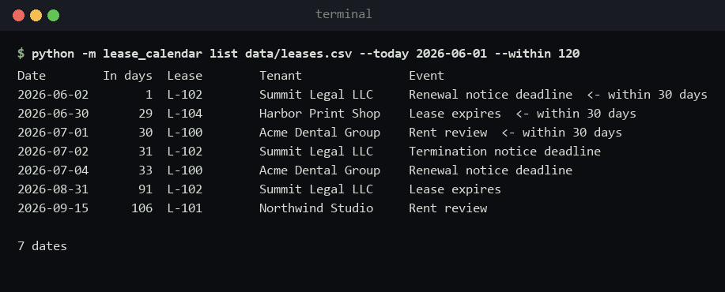

# lease-expiry-calendar

Missed lease notice deadlines are expensive: miss one and a tenant renews by default, or a rent review passes unnoticed. This repo reads a lease register CSV, works out every critical date (expiry, renewal notice deadline, termination notice deadline and rent review), lists them with days remaining, and can write them to an .ics calendar file.



## What it is for

Property managers keep expiry dates in a register but the real deadlines are earlier: the expiry date minus the notice period. This tool turns the register into one sorted list of dates, marks anything within 30 days, and exports an iCalendar file with a 7 day reminder on each event that opens in any calendar app.

## Install

```
git clone https://github.com/yassine2med/lease-expiry-calendar
cd lease-expiry-calendar && pip install -r requirements.txt
```

## How to use

| I want to | Command |
|---|---|
| List upcoming critical dates | `PYTHONPATH=src python -m lease_calendar list data/leases.csv --today 2026-06-01 --within 120` |
| Use today's date and list everything coming up | `PYTHONPATH=src python -m lease_calendar list data/leases.csv` |
| Include dates that have already passed | `PYTHONPATH=src python -m lease_calendar list data/leases.csv --today 2026-06-01 --within 120 --include-past` |
| Write an .ics calendar file | `PYTHONPATH=src python -m lease_calendar ics data/leases.csv --today 2026-06-01 --out lease-dates.ics` |
| Show help | `PYTHONPATH=src python -m lease_calendar --help` |

Exit codes: 0 on success, 1 on bad input (missing column, date not in YYYY-MM-DD, notice days not a whole number). Register columns: lease, tenant and expiry are required; renewal_notice_days, termination_notice_days and rent_review are optional.

Example:

```
PYTHONPATH=src python -m lease_calendar list data/leases.csv --today 2026-06-01 --within 120
```

Output:

```
Date        In days  Lease        Tenant               Event
2026-06-02        1  L-102        Summit Legal LLC     Renewal notice deadline  <- within 30 days
2026-06-30       29  L-104        Harbor Print Shop    Lease expires  <- within 30 days
2026-07-01       30  L-100        Acme Dental Group    Rent review  <- within 30 days
2026-07-02       31  L-102        Summit Legal LLC     Termination notice deadline
2026-07-04       33  L-100        Acme Dental Group    Renewal notice deadline
2026-08-31       91  L-102        Summit Legal LLC     Lease expires
2026-09-15      106  L-101        Northwind Studio     Rent review

7 dates
```

Run the tests with `python -m pytest -q`.

## How it works

1. Each register row gives a Lease expires event on the expiry date.
2. If renewal_notice_days is filled in, a Renewal notice deadline is added at expiry minus that many days. The same applies to termination_notice_days.
3. If rent_review is filled in, a Rent review event is added on that date.
4. Events are sorted by date. Past dates are dropped unless `--include-past` is used, and `--within N` keeps only dates in the next N days.
5. The `ics` command writes one all-day event per date with a display reminder 7 days before.

## Limits

- CSV input only, with dates as YYYY-MM-DD.
- One expiry per lease. Options, extensions and multiple review dates are not modeled.
- Notice deadlines are calendar days before expiry, with no adjustment for weekends or holidays.
- The calendar file is a one-time export; re-importing it after changes can create duplicates in some calendar apps.

## License

MIT. Yassine Emhamed, 2026.
